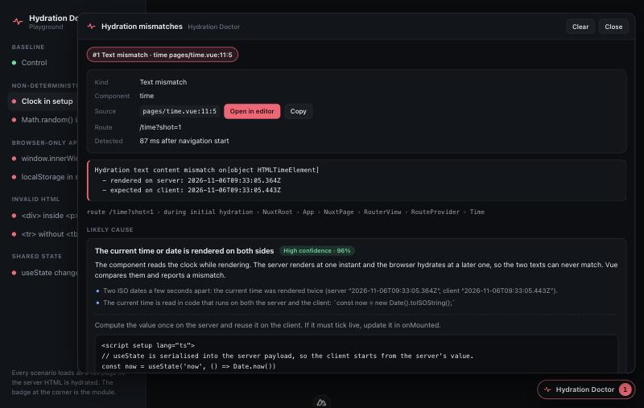
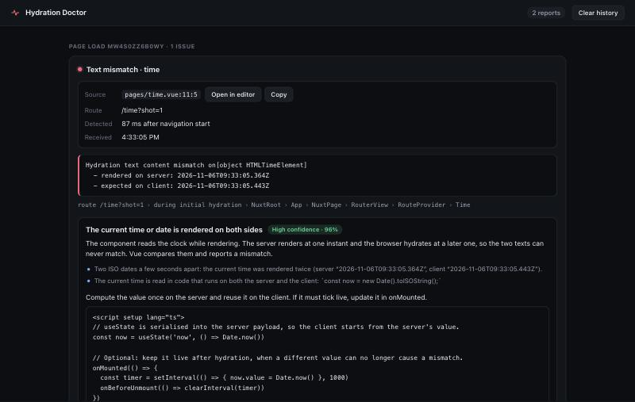
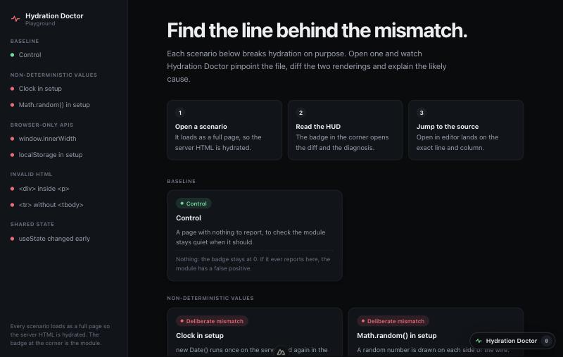

# nuxt-hydration-doctor

**Find, diff and fix Vue 3 / Nuxt SSR hydration mismatches in development, down to the file and line, with zero footprint in production.**

[](LICENSE)


[](https://www.npmjs.com/package/nuxt-hydration-doctor)

`nuxt-hydration-doctor` is a Nuxt module that turns Vue's vague `[Vue warn]: Hydration node mismatch` into something you can act on: the **exact `.vue` file, line and column**, a **side-by-side diff of the server HTML and the client DOM**, and a **likely root cause with a fix you can paste**. It works in `nuxt dev` only and adds nothing to your production build.

## Table of contents

- [Why](#why)
- [Features](#features)
- [Quick start](#quick-start)
- [Configuration](#configuration)
- [How it looks](#how-it-looks)
- [What it recognises](#what-it-recognises)
- [Zero production footprint](#zero-production-footprint)
- [Security](#security)
- [Verified against](#verified-against)
- [Known limits](#known-limits)
- [FAQ](#faq)
- [Development](#development)
- [Roadmap](#roadmap)
- [License](#license)

## Why

A hydration mismatch happens when the HTML a Nuxt server rendered is not what Vue builds in the browser. The warning in the console names a DOM node, not your component, and says nothing about _why_. Typical culprits are a clock or `Math.random()` read during `setup`, `window` or `localStorage` used on the first render, invalid HTML that the browser silently repairs (`<div>` inside `<p>`, `<tr>` outside `<tbody>`), or shared state changed before hydration finishes.

This module answers three questions the console does not: **where** (file, line, component), **what differs** (a real diff), and **why** (a cause backed by evidence, never a guess).

## Features

- **Source location.** A dev-only Vite transform stamps each template element with `data-nhd-loc="file:line:col"`, so a mismatch is traced to the line that produced it. "Open in editor" jumps there.
- **Live capture.** Hooks Vue's warning handler without silencing the default console output, and snapshots the server HTML before hydration so the diff shows what the server really sent.
- **Isolated HUD.** A draggable badge and panel in a Shadow DOM: your page's CSS cannot break it and its CSS cannot leak. Light and dark themes follow the system setting.
- **Diagnosis with evidence.** Four rules (browser-only values, non-deterministic values, invalid HTML nesting, state changed before mount) that fire only on observed evidence and state a confidence.
- **Nuxt DevTools tab.** The session history with the same diagnoses and "Open in editor" links.
- **Strict by design.** Unknown or mistyped options fail the build with the option path; runtime errors never crash your app.

## Quick start

```bash
npm install -D nuxt-hydration-doctor
```

```ts
// nuxt.config.ts
export default defineNuxtConfig({
  modules: ['nuxt-hydration-doctor'],
});
```

Run `nuxt dev`, load a page with a mismatch, and open the **Hydration Doctor** badge in the corner. Supports Nuxt `^3.15` and `^4`, Node `^20.19 || >=22.12`, ESM only.

## Configuration

Every option is optional; shown with its default.

```ts
export default defineNuxtConfig({
  modules: ['nuxt-hydration-doctor'],
  hydrationDoctor: {
    enabled: true, // still inert outside `nuxt dev`
    debug: false,
    sourceMap: { attribute: 'data-nhd-loc', exclude: ['/node_modules/'] },
    hud: {
      enabled: true,
      autoOpen: true,
      position: 'bottom-right', // or bottom-left, top-right, top-left
    },
    devtools: { enabled: true },
    history: { limit: 50 },
    diagnostics: { disabledCategories: [] }, // e.g. ['invalid-html-nesting']
  },
});
```

**Moving the badge.** It can land where another debug bar already is, so drag it anywhere (mouse, touch or pen), or focus it and press **Alt + an arrow key**. The position is remembered in `localStorage`; **Reset position** returns it to the corner set by `hud.position`. The panel opens on the badge's side of the screen.

## How it looks

For each mismatch the HUD shows the kind, component, source location (with **Open in editor** and **Copy**), Vue's own message, the component breadcrumbs, the diagnosis with its evidence and a copyable fix, and the **Server Rendered HTML** against the **Client Rendered DOM** with the diverging parts highlighted. The offending element is outlined on the page.



The same reports appear in a tab of Nuxt DevTools:



Run the playground (see [Development](#development)) to see all of it: it has one page per scenario.



## What it recognises

Vue's text, node, children, class, style and attribute hydration warnings. When the evidence supports one, you also get a likely cause:

| Cause                      | What gives it away                                                                                                                                                    |
| -------------------------- | --------------------------------------------------------------------------------------------------------------------------------------------------------------------- |
| Browser-only value         | the client text contains the live value of `window.innerWidth`, `navigator.userAgent`, a `localStorage` entry…; `window`/`document` read in `setup`                   |
| Non-deterministic value    | timestamps seconds apart, a whole-hour difference (time zone), 12h against 24h (locale), different UUIDs or random decimals; `Date.now()`, `Math.random()` in `setup` |
| Invalid HTML nesting       | `<div>` in `<p>`, `<tr>` outside `<tbody>`, `<a>` in `<a>`… (the browser's parser repairs the server HTML, Vue does not repair its own DOM)                           |
| State changed before mount | a `useState` or Pinia value differs from what the server serialised                                                                                                   |

A diagnosis states the evidence it rests on and a confidence. When nothing matches, it says so instead of guessing. State and storage _values_ are never printed, only their keys.

## Zero production footprint

Everything is registered below a single guard, `shouldActivate(options, nuxt.options.dev)`. With `dev: false` the module registers no plugin, no Vite transform, no component, no DevTools tab and sets no public config. `npm run verify:production` builds the playground for real and scans the output for any trace of the module.

## Security

The DevTools tab talks to a dev-only endpoint (`/__nhd`). It refuses foreign `Host` names (DNS rebinding) and cross-site requests, requires a marker header on writes, caps bodies at 256 KB, rebuilds every report from known fields, serves the page under a strict CSP with no inline script, and confines "Open in editor" to the project and its layers. Page content is only ever rendered as text. To report a vulnerability, see [SECURITY.md](SECURITY.md).

## Verified against

| Nuxt                  | Checked                                                                              |
| --------------------- | ------------------------------------------------------------------------------------ |
| 4.6.4 (DevTools 3.4)  | the whole suite, a production build, the built `dist/` in a separate project         |
| 3.21.11               | the built `dist/` in a separate project: registers in development, nothing otherwise |
| 3.15.0 (DevTools 1.7) | the same                                                                             |

- **Real browser, by hand.** On Nuxt 4.6.4 the playground was run in a Chromium-based browser: all eight pages behave as intended (the control reports nothing; each of the seven scenarios is captured and diagnosed), and the HUD and DevTools tab render in light and dark.
- **Automated.** Unit, architecture, integration (real `createSSRApp` hydration in happy-dom) and `dist/` suites run in CI.
- **Not yet run.** The Playwright suite (`tests/e2e`) is written and type-checked but has never been executed, and Nuxt 3 has only been checked at the level of what the module registers.

## Known limits

- Only single-file components are located: render functions, JSX/TSX and Pug (`lang` other than `html`) templates get no `data-nhd-loc`, so a mismatch in them is reported without a source line. A PascalCase native tag such as `<DIV>` is treated as a component by Vue and is skipped too.
- **Static template chunks are not checked by Vue itself.** The Vue compiler turns a long run of static elements into one static node and hydrates it by counting nodes. A mismatch inside such a chunk raises no warning, so there is nothing for this module to capture. Keep dynamic content near the markup you are debugging.
- The server markup is captured from the application root and the teleport container before hydration. A mismatch outside both has no server side to compare.
- Vue only _checks_ class, style and attribute mismatches and does not repair them, so for those the "client" markup still holds the server's value; the exact values are in the message.
- A report needs the dev endpoint (`/__nhd`), which Nuxt mounts at the server root. It answers loopback names and IP addresses; reaching the dev server through another host name needs that name in `devServer.host` or `vite.server.allowedHosts`.
- "Open in editor" works for files of the project and of its Nuxt layers, through Nuxt's own `/__open-in-editor` route.
- Heuristics can be wrong. A diagnosis below 55% confidence is labelled low; below 30% it is not shown.

## FAQ

**What is a hydration mismatch in Nuxt?**
The server rendered HTML that differs from what Vue renders in the browser during hydration. Vue logs a warning, and may patch or discard parts of the DOM.

**Does it affect my production build?**
No. It does nothing unless Nuxt runs in development, and the production bundle is scanned for traces in CI.

**Does it work with Nuxt 3?**
Yes, `^3.15` and `^4`. See [Verified against](#verified-against) for what was checked on each.

**Why does a mismatch show no source line?**
The element came from a render function, JSX or a non-HTML template language, or from outside your components. See [Known limits](#known-limits).

**Why is no mismatch reported for markup I know is invalid?**
Vue may be hydrating it as a static chunk and not checking it. See [Known limits](#known-limits).

## Development

```bash
npm install
npm run dev:prepare
npm run check    # format, lint, typecheck, arch, test, build, verify:package, verify:dist, verify:production
npm run dev      # playground at http://localhost:3000
```

The [playground](playground/pages/index.vue) has a page for each cause the doctor recognises (clock, random value, `window`, `localStorage`, `<div>` in `<p>`, `<tr>` in `<table>`, state changed before hydration) and a control page that hydrates cleanly. Open one with a full page load: the HUD appears in the corner, and the same report shows up in the **Hydration Doctor** tab of Nuxt DevTools.

End-to-end tests drive a real browser against the dev server:

```bash
npx playwright install chromium   # once
npm run test:e2e
```

Contributing: [CONTRIBUTING.md](CONTRIBUTING.md). Conduct: [CODE_OF_CONDUCT.md](CODE_OF_CONDUCT.md).

## Roadmap

| Phase | Scope                                                               | Status |
| ----- | ------------------------------------------------------------------- | ------ |
| 1     | Scaffolding, Nuxt Kit setup, `src/module.ts`, strict TS and tooling | Done   |
| 2     | Vite AST transform injecting `data-nhd-loc` (dev only)              | Done   |
| 3     | Runtime plugin: warning interception and DOM capture                | Done   |
| 4     | Shadow DOM HUD with visual diff                                     | Done   |
| 5     | Diagnostic engine and fix suggestions                               | Done   |
| 6     | DevTools tab, playground scenarios, Playwright E2E                  | Done\* |

\* The Playwright suite has never been run; see [Verified against](#verified-against).

## License

[MIT](LICENSE) © Nhữ Duy Thìn
